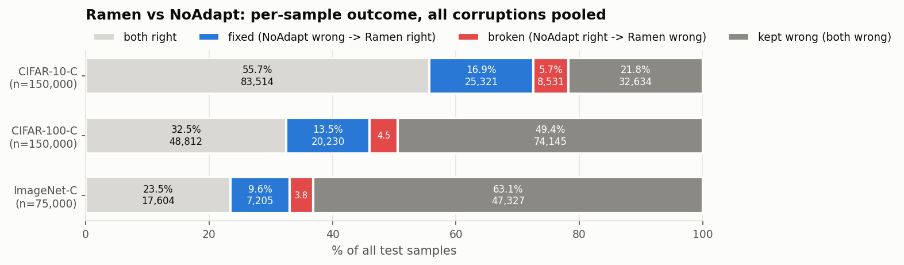
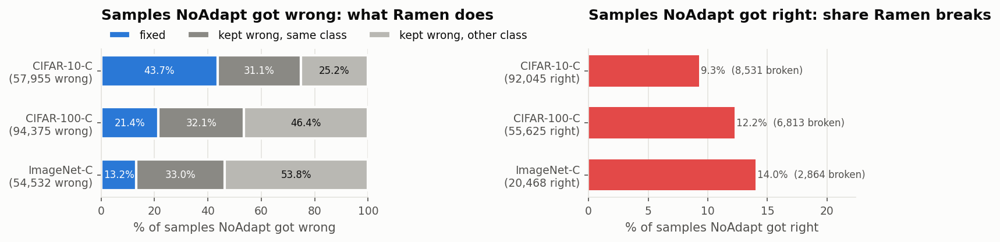
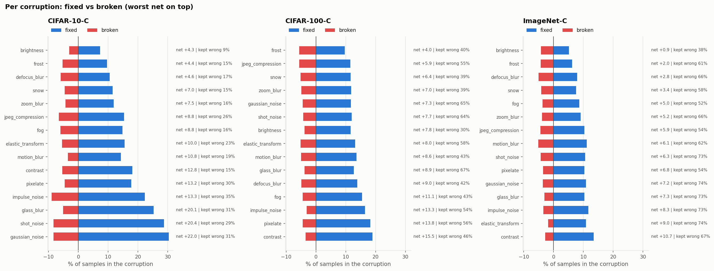
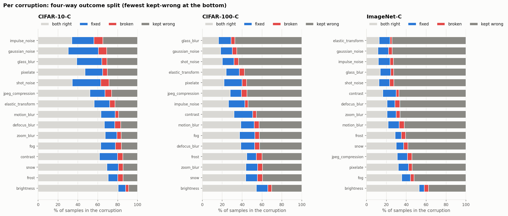

# Ramen vs NoAdapt: fixes, breaks and kept-wrong samples (as of 2026-10-22)

Mixed-domain stream (all corruptions shuffled together), severity 5, seed 0, batch size 100. Models: CIFAR-10-C ViT-B/32, CIFAR-100-C ViT-B/16, ImageNet-C ViT-B/16. Both methods see the same samples in the same order, so each sample is paired with itself:

- **fixed**: NoAdapt wrong, Ramen right
- **broken**: NoAdapt right, Ramen wrong
- **kept wrong**: both wrong. *same class* means Ramen made the same wrong prediction as NoAdapt, *other class* means it switched to a different wrong class
- **both right**: both right

## Overall counts

| dataset | n | fixed | broken | net fixed | kept wrong | kept wrong, same class | kept wrong, other class | both right |
|---|---|---|---|---|---|---|---|---|
| CIFAR-10-C | 150,000 | 25,321 | 8,531 | 16,790 | 32,634 | 18,019 | 14,615 | 83,514 |
| CIFAR-100-C | 150,000 | 20,230 | 6,813 | 13,417 | 74,145 | 30,316 | 43,829 | 48,812 |
| ImageNet-C | 75,000 | 7,205 | 2,864 | 4,341 | 47,327 | 18,015 | 29,312 | 17,604 |

## Overall percentages (% of all samples)

| dataset | fixed % | broken % | net % | kept wrong % | both right % | NoAdapt acc % | Ramen acc % |
|---|---|---|---|---|---|---|---|
| CIFAR-10-C | 16.88 | 5.69 | 11.19 | 21.76 | 55.68 | 61.36 | 72.56 |
| CIFAR-100-C | 13.49 | 4.54 | 8.94 | 49.43 | 32.54 | 37.08 | 46.03 |
| ImageNet-C | 9.61 | 3.82 | 5.79 | 63.10 | 23.47 | 27.29 | 33.08 |

## Conditional rates

| dataset | fix rate % (of NoAdapt wrong) | kept-wrong rate % (of NoAdapt wrong) | break rate % (of NoAdapt right) |
|---|---|---|---|
| CIFAR-10-C | 43.69 | 56.31 | 9.27 |
| CIFAR-100-C | 21.44 | 78.56 | 12.25 |
| ImageNet-C | 13.21 | 86.79 | 13.99 |

The fix rate is fixed / (fixed + kept wrong). The break rate is broken / (broken + both right).

## Overall outcome split

## What happens to NoAdapt-wrong and NoAdapt-right samples

## Per corruption: fixed vs broken

## Per corruption: four-way split

## Per-corruption breakdown

### CIFAR-10-C

| corruption | n | fixed | broken | kept wrong | fixed % | broken % | net % | kept wrong % |
|---|---|---|---|---|---|---|---|---|
| brightness | 10,000 | 734 | 306 | 902 | 7.34 | 3.06 | 4.28 | 9.02 |
| frost | 10,000 | 966 | 527 | 1,461 | 9.66 | 5.27 | 4.39 | 14.61 |
| defocus_blur | 10,000 | 1,049 | 593 | 1,692 | 10.49 | 5.93 | 4.56 | 16.92 |
| snow | 10,000 | 1,152 | 457 | 1,466 | 11.52 | 4.57 | 6.95 | 14.66 |
| zoom_blur | 10,000 | 1,182 | 433 | 1,646 | 11.82 | 4.33 | 7.49 | 16.46 |
| jpeg_compression | 10,000 | 1,534 | 654 | 2,609 | 15.34 | 6.54 | 8.80 | 26.09 |
| fog | 10,000 | 1,479 | 598 | 1,628 | 14.79 | 5.98 | 8.81 | 16.28 |
| elastic_transform | 10,000 | 1,549 | 550 | 2,262 | 15.49 | 5.50 | 9.99 | 22.62 |
| motion_blur | 10,000 | 1,428 | 349 | 1,901 | 14.28 | 3.49 | 10.79 | 19.01 |
| contrast | 10,000 | 1,814 | 534 | 1,483 | 18.14 | 5.34 | 12.80 | 14.83 |
| pixelate | 10,000 | 1,775 | 456 | 3,043 | 17.75 | 4.56 | 13.19 | 30.43 |
| impulse_noise | 10,000 | 2,226 | 892 | 3,492 | 22.26 | 8.92 | 13.34 | 34.92 |
| glass_blur | 10,000 | 2,523 | 515 | 3,089 | 25.23 | 5.15 | 20.08 | 30.89 |
| shot_noise | 10,000 | 2,873 | 834 | 2,860 | 28.73 | 8.34 | 20.39 | 28.60 |
| gaussian_noise | 10,000 | 3,037 | 833 | 3,100 | 30.37 | 8.33 | 22.04 | 31.00 |

### CIFAR-100-C

| corruption | n | fixed | broken | kept wrong | fixed % | broken % | net % | kept wrong % |
|---|---|---|---|---|---|---|---|---|
| frost | 10,000 | 962 | 561 | 3,997 | 9.62 | 5.61 | 4.01 | 39.97 |
| jpeg_compression | 10,000 | 1,149 | 558 | 5,498 | 11.49 | 5.58 | 5.91 | 54.98 |
| snow | 10,000 | 1,161 | 520 | 3,947 | 11.61 | 5.20 | 6.41 | 39.47 |
| zoom_blur | 10,000 | 1,183 | 486 | 3,949 | 11.83 | 4.86 | 6.97 | 39.49 |
| gaussian_noise | 10,000 | 1,175 | 444 | 6,534 | 11.75 | 4.44 | 7.31 | 65.34 |
| shot_noise | 10,000 | 1,195 | 428 | 6,373 | 11.95 | 4.28 | 7.67 | 63.73 |
| brightness | 10,000 | 1,162 | 384 | 3,029 | 11.62 | 3.84 | 7.78 | 30.29 |
| elastic_transform | 10,000 | 1,317 | 515 | 5,767 | 13.17 | 5.15 | 8.02 | 57.67 |
| motion_blur | 10,000 | 1,360 | 498 | 4,279 | 13.60 | 4.98 | 8.62 | 42.79 |
| glass_blur | 10,000 | 1,272 | 386 | 6,719 | 12.72 | 3.86 | 8.86 | 67.19 |
| defocus_blur | 10,000 | 1,384 | 487 | 4,248 | 13.84 | 4.87 | 8.97 | 42.48 |
| fog | 10,000 | 1,548 | 442 | 4,276 | 15.48 | 4.42 | 11.06 | 42.76 |
| impulse_noise | 10,000 | 1,641 | 314 | 5,404 | 16.41 | 3.14 | 13.27 | 54.04 |
| pixelate | 10,000 | 1,824 | 442 | 5,552 | 18.24 | 4.42 | 13.82 | 55.52 |
| contrast | 10,000 | 1,897 | 348 | 4,573 | 18.97 | 3.48 | 15.49 | 45.73 |

### ImageNet-C

| corruption | n | fixed | broken | kept wrong | fixed % | broken % | net % | kept wrong % |
|---|---|---|---|---|---|---|---|---|
| brightness | 5,000 | 256 | 212 | 1,880 | 5.12 | 4.24 | 0.88 | 37.60 |
| frost | 5,000 | 312 | 214 | 3,037 | 6.24 | 4.28 | 1.96 | 60.74 |
| defocus_blur | 5,000 | 395 | 253 | 3,321 | 7.90 | 5.06 | 2.84 | 66.42 |
| snow | 5,000 | 377 | 207 | 2,923 | 7.54 | 4.14 | 3.40 | 58.46 |
| fog | 5,000 | 431 | 183 | 2,610 | 8.62 | 3.66 | 4.96 | 52.20 |
| zoom_blur | 5,000 | 454 | 195 | 3,317 | 9.08 | 3.90 | 5.18 | 66.34 |
| jpeg_compression | 5,000 | 516 | 219 | 2,719 | 10.32 | 4.38 | 5.94 | 54.38 |
| motion_blur | 5,000 | 558 | 255 | 3,101 | 11.16 | 5.10 | 6.06 | 62.02 |
| shot_noise | 5,000 | 530 | 215 | 3,626 | 10.60 | 4.30 | 6.30 | 72.52 |
| pixelate | 5,000 | 514 | 176 | 2,706 | 10.28 | 3.52 | 6.76 | 54.12 |
| gaussian_noise | 5,000 | 542 | 180 | 3,708 | 10.84 | 3.60 | 7.24 | 74.16 |
| glass_blur | 5,000 | 518 | 153 | 3,637 | 10.36 | 3.06 | 7.30 | 72.74 |
| impulse_noise | 5,000 | 585 | 171 | 3,647 | 11.70 | 3.42 | 8.28 | 72.94 |
| elastic_transform | 5,000 | 543 | 93 | 3,723 | 10.86 | 1.86 | 9.00 | 74.46 |
| contrast | 5,000 | 674 | 138 | 3,372 | 13.48 | 2.76 | 10.72 | 67.44 |

CSV files: `overall.csv`, `per_corruption.csv`.
