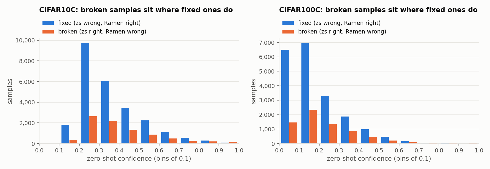
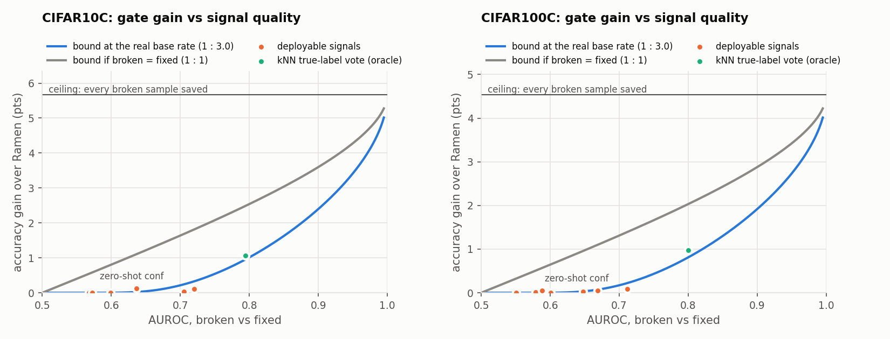

# Why the confidence gate fails

Written 2026-10-05. Backs up and corrects the explanation of the failed confidence gate in
[ramen-research-directions.md](../../src/ramen-research-directions.md) (Section 1.6, Appendix A).
Every number below is produced by [gate_analysis.py](gate_analysis.py) in this folder. The full output is in
[results/summary.md](results/summary.md) (one CSV per table in [results/](results/)).

**Data.** Full CIFAR-10-C (ViT-B/32) and CIFAR-100-C (ViT-B/16), severity 5, mixed mode, 15 corruptions ×
10,000 images = 150,000 samples each, seed 0. These are the per-sample caches in `new_experiments/results/`
written by the `*_ramen.ipynb` notebooks: NoAdapt and Ramen on the identical stream, plus zero-shot image
features.

**Reproduce** (from the repo root, about 10 s on one GPU):

```bash
~/miniconda3/envs/RAMEN/bin/python observations/confidence_gate/gate_analysis.py --device cuda:0
```

No model is run. Only the kNN signals in O4 and O6 use the GPU; `--device cpu` also works, just more slowly.

---

## Summary

The gate "keep zero-shot's prediction when zero-shot confidence ≥ τ" can only gain by saving more *broken*
samples (zero-shot right, Ramen wrong) than it loses *fixed* ones (zero-shot wrong, Ramen right). It fails for
two compounding reasons:

1. **Zero-shot confidence barely separates broken from fixed samples** (AUROC 0.57 / 0.58). Both groups sit
   at low confidence, and the high-confidence region where a gate is safe contains almost no disagreements.
2. **The base rate is 1 broken : 3 fixed.** A gate only gains where broken samples outnumber fixed ones. That
   takes a much stronger signal than it would at 1 : 1. At this base rate an AUROC of 0.70 can gain at most
   about 0.2 pts, and gaining +1 pt needs about 0.80.

None of the label-free signals tested here clears that bar. The best is *zero-shot conf − Ramen conf* (AUROC
0.72 / 0.71). Even with its threshold tuned on the test stream itself, it gains only +0.10 / +0.09 pts. A
nearest-neighbour vote using **true** labels reaches AUROC 0.79–0.80 and +1.0 pts. So zero-shot feature space
does hold the information, but no label-free signal tested here recovers it.

Rows are CIFAR-10-C / CIFAR-100-C throughout.

| observation | evidence | table |
|---|---|---|
| O1 Gate gain = (broken saved − fixed lost) / N, exactly | identity asserted for every τ | `gate_sweep` |
| O2 Broken and fixed samples have nearly the same zero-shot confidence | medians 0.35 vs 0.31 / 0.18 vs 0.14 | `conf_by_outcome`, `conf_bins` |
| O3 A gate at safe τ reaches almost none of the harm | τ = 0.8 covers 4.2% / 0.5% of broken samples | `reach` |
| O4 Every tested signal is too weak for a 1 : 3 base rate | best label-free gate: +0.10 / +0.09 pts | `signals`, `bound` |
| O5 Over-prediction concentrates breaks but is no per-sample selector | ρ = 0.60 / 0.62 per class; AUROC ≤ 0.65 | `into_overpredicted`, `per_class` |
| O6 Broken samples mostly sit near their *true* class in zero-shot space | 39% vs 20% / 23% vs 9% of neighbours | `neighbourhood` |

---

## Background: why the post-hoc gate is exact

The gate is simulated from the cached results, without re-running Ramen. This is exact for a hard gate,
for the reasons given in Appendix A.1 of the directions doc:

- In `Ramen.forward` ([src/methods/Ramen.py](../../src/methods/Ramen.py)), the first logits (line 115) are
  zero-shot, because the weights are reset after every batch (line 168).
- The memory is written (line 130) before any adaptation, so skipping a sample's update doesn't change what any
  other sample retrieves.
- The optimizer is SignSGD with no momentum or weight decay (`cfg/CIFAR10C/Ramen.yaml`,
  `cfg/CIFAR100C/Ramen.yaml`). A zero gradient row therefore leaves that sample's prediction exactly zero-shot.

So for any rule that picks either the zero-shot or the Ramen prediction per sample, the result follows directly
from the two cached prediction columns.

---

## O1. A gate's gain is broken saved minus fixed lost

Each sample falls into one of five outcomes (table `outcomes`):

| outcome | CIFAR-10-C | CIFAR-100-C |
|---|---|---|
| fixed (zs wrong, Ramen right) | 25,381 (16.9%) | 20,300 (13.5%) |
| broken (zs right, Ramen wrong) | 8,498 (5.7%) | 6,800 (4.5%) |
| both right | 83,535 (55.7%) | 48,844 (32.6%) |
| both wrong, different predictions | 14,586 (9.7%) | 43,760 (29.2%) |
| both wrong, same prediction | 18,000 (12.0%) | 30,296 (20.2%) |
| **P(zs right \| exactly one is right)** | **25.1%** | **25.1%** |

Switching a sample from Ramen to zero-shot changes accuracy only if exactly one of them is right. So for any
gated set G:

> accuracy(gated) − accuracy(Ramen) = (|G ∩ broken| − |G ∩ fixed|) / N

The script asserts this for every τ (`gate_table`). Two consequences follow:

- **Both-wrong disagreements don't matter.** They are 30% of disagreements on CIFAR-10-C and 62% on
  CIFAR-100-C, but the gate cannot gain or lose anything on them. Any signal should be judged on **broken vs
  fixed** only (see O4 for how this changes the AUROCs in the directions doc).
- **A gate gains only where broken outnumber fixed.** Overall, broken samples are a quarter of the samples
  that matter, so a selector has to find regions where that share is at least 50%.

The sweep reproduces Appendix A of the directions doc to the last digit (table `gate_sweep`):

| τ | gated (% of stream) | gated samples that disagree | broken saved / fixed lost | gain (pts) |
|---|---|---|---|---|
| 0.5 | 55.0% / 23.5% | 8.8% / 4.0% | 1,986 / 4,283 · 352 / 708 | −1.53 / −0.24 |
| 0.7 | 39.0% / 14.2% | 3.0% / 0.8% | 625 / 914 · 62 / 73 | −0.19 / −0.01 |
| 0.8 | 31.6% / 10.3% | 1.7% / 0.5% | 359 / 366 · 34 / 25 | −0.00 / +0.01 |
| 0.9 | 22.1% / 6.1% | 0.8% / 0.3% | 170 / 83 · 14 / 7 | +0.06 / +0.00 |

At τ = 0.8 the gate covers a third of the CIFAR-10-C stream, but only 1.7% of those samples have different
predictions, so it can't change much.

---

## O2. Broken and fixed samples have nearly the same zero-shot confidence

Zero-shot confidence quartiles by outcome (table `conf_by_outcome`):

| outcome | CIFAR-10-C (25% / 50% / 75%) | CIFAR-100-C (25% / 50% / 75%) |
|---|---|---|
| both right | 0.56 / 0.83 / 0.95 | 0.31 / 0.56 / 0.84 |
| **broken** | 0.27 / **0.35** / 0.49 | 0.11 / **0.18** / 0.29 |
| **fixed** | 0.25 / **0.31** / 0.44 | 0.09 / **0.14** / 0.25 |
| both wrong, disagree | 0.23 / 0.28 / 0.35 | 0.07 / 0.10 / 0.16 |

The broken and fixed distributions overlap almost entirely. Broken samples are only slightly more confident.
Both are far below the samples both methods get right.



Per confidence bin (table `conf_bins`), broken samples make up 17–33% of broken + fixed in every CIFAR-10-C bin
below 0.8, and 18–37% in every CIFAR-100-C bin below 0.8. Keeping zero-shot in any of those bins loses
accuracy. The share passes 50% only in the top bins (0.9–1.0 on CIFAR-10-C: 170 vs 83; 0.8–1.0 on CIFAR-100-C:
34 vs 25). Those bins hold only 0.7% / 0.2% of all broken + fixed samples.

---

## O3. A gate at a safe τ reaches almost none of the harm

Table `reach`:

| τ | % of all broken samples with conf ≥ τ | % of all fixed with conf ≥ τ | broken share inside the gate |
|---|---|---|---|
| 0.5 | 23.4% / 5.2% | 16.9% / 3.5% | 31.7% / 33.2% |
| 0.7 | 7.4% / 0.9% | 3.6% / 0.4% | 40.6% / 45.9% |
| 0.8 | 4.2% / 0.5% | 1.4% / 0.1% | 49.5% / 57.6% |
| 0.9 | 2.0% / 0.2% | 0.3% / 0.0% | 67.2% / 66.7% |

The gate becomes net-positive around τ = 0.8–0.9. By then it can reach at most 2–4% of the broken samples on
CIFAR-10-C and under 0.5% on CIFAR-100-C. **Over 95% of the harm happens at confidence levels where fixes
outnumber breaks by 2:1 or more.** That's why the best possible zero-shot-confidence gate gains only +0.06 /
+0.01 pts.

---

## O4. Every tested signal is too weak for a 1 : 3 base rate

### Signals

Each signal is scored so that high means "keep zero-shot" (table `signals`). "Best gate" is the best gain of
"keep zero-shot when score ≥ t", with t **tuned on the test stream**. That's optimistic, an upper bound on
what the signal can deliver.

| signal | AUROC broken vs fixed | AUROC, directions-doc definition | best gate gain (pts) |
|---|---|---|---|
| zero-shot conf | 0.571 / 0.579 | 0.609 / 0.673 | +0.06 / +0.01 |
| −zero-shot entropy | 0.570 / 0.551 | 0.609 / 0.645 | +0.06 / +0.01 |
| −Ramen conf | 0.705 / 0.669 | 0.605 / 0.463 | +0.04 / +0.05 |
| **zero-shot conf − Ramen conf** | **0.720 / 0.711** | 0.659 / 0.558 | **+0.10 / +0.09** |
| overshoot of Ramen's class (whole stream) | 0.568 / 0.599 | 0.550 / 0.504 | +0.00 / +0.00 |
| overshoot of Ramen's class (running, causal) | 0.573 / 0.601 | 0.556 / 0.509 | +0.00 / +0.00 |
| overshoot of Ramen's class − zs class (running) | 0.599 / 0.647 | 0.586 / 0.586 | +0.00 / +0.03 |
| kNN pseudo-label vote, causal (k = 20) | 0.636 / 0.589 | – | +0.13 / +0.05 |
| *kNN true-label vote (oracle, k = 20)* | *0.794 / 0.800* | – | *+1.06 / +0.98* |

Signal definitions (all in `signals()`):
- *Overshoot of a class*: its share of Ramen's predictions × K − 1, against a uniform target (CIFAR-C is
  exactly balanced). The whole-stream version uses every prediction. The running version uses only earlier
  batches, so a real system could compute it.
- *kNN vote*: the 20 nearest neighbours by cosine similarity in **zero-shot** feature space. The score is the
  fraction of neighbours labelled with zero-shot's class minus the fraction labelled with Ramen's class. The
  causal version uses Ramen's predictions as labels and only earlier batches, a rough stand-in for Direction
  2's "support-set agreement". The oracle version uses true labels and the whole stream. It isn't deployable;
  it's there to show whether zero-shot feature space holds the information at all. Both exclude the query's
  own underlying image in all 15 corruptions.

**Why the directions-doc AUROCs differ.** The doc's Section 1.6 numbers (0.609 / 0.673, 0.605 / 0.463, …) are
reproduced exactly with label = "zero-shot right" over *all* disagreements. That counts the both-wrong
disagreements as negatives, even though a gate can't affect them (O1). Ramen's confidence is low on those
samples, so on CIFAR-100-C, where they are 62% of disagreements, Ramen's confidence looks inverted (0.463). On
the set that matters, broken vs fixed, it's the opposite: Ramen's confidence (0.67–0.71) is a better signal
than zero-shot's (0.57–0.58).

### How much a gate can gain for a given AUROC

Model the signal as Gaussian with equal variance on broken and fixed samples (equal-variance binormal, AUROC
= Φ(d/√2)). The best threshold is then t* = d/2 + ln(n_fixed / n_broken)/d. Table `bound`:

| AUROC | max gain at the real base rate (1 : 3) | max gain if broken = fixed (1 : 1) |
|---|---|---|
| 0.60 | 0.00 / 0.00 | 0.81 / 0.64 |
| 0.70 | 0.21 / 0.17 | 1.64 / 1.31 |
| 0.75 | 0.54 / 0.43 | 2.08 / 1.66 |
| 0.80 | 1.01 / 0.81 | 2.54 / 2.03 |
| 0.90 | 2.40 / 1.92 | 3.60 / 2.88 |
| ceiling | 5.67 / 4.53 | 5.67 / 4.53 |



The measured signals track the curve. They don't match it exactly, because their real score distributions
aren't equal-variance Gaussian. The best label-free signal (AUROC 0.72) gains +0.10 against the curve's +0.33
on CIFAR-10-C. The causal kNN vote and the oracle sit slightly above it (+0.13 against +0.02 at AUROC 0.64;
+0.98 against +0.81 at 0.80 on CIFAR-100-C). Either way, label-free signals cluster at AUROC 0.57–0.72, with
gains of at most +0.13 pts, where the curve is still flat. Without the 1 : 3 imbalance, the same zero-shot
confidence signal could have gained about +0.5–0.6 pts.

**Bar for Direction 2.** At this base rate, a selector needs AUROC (broken vs fixed) of about 0.75 to gain
+0.5 pts and about 0.80 to gain +1 pt. The "clearly > 0.67" target in the directions doc uses the other
definition and is too low.

---

## O5. Over-prediction concentrates the breaks, but can't pick out samples

Ramen's over-correction (Section 1.5 of the doc) does show up in where it breaks predictions (table
`into_overpredicted`):

| | Ramen's class is over-predicted | median overshoot of Ramen's class |
|---|---|---|
| broken | 59.1% / 67.8% | +9.8% / +19.9% |
| fixed | 54.4% / 51.5% | +1.2% / +0.5% |

Per target class, the more a class is over-predicted, the larger the broken share among the samples moved into
it. Spearman ρ is 0.62 (p = 5e-12, 100 classes) on CIFAR-100-C and 0.60 on CIFAR-10-C, where 10 classes are too
few for significance (p = 0.07). See tables `per_class` and `per_class_all`.

**Even in the most over-predicted classes, fixes outnumber breaks** (table `per_class`):

| class | overshoot | broken into it | fixed into it |
|---|---|---|---|
| deer (CIFAR-10-C) | +27.7% | 2,437 | 4,654 |
| horse | +15.2% | 936 | 2,140 |
| truck | +9.8% | 1,210 | 4,992 |
| fox (CIFAR-100-C) | +109.5% | 113 | 213 |
| oak tree | +104.5% | 168 | 196 |
| tractor | +70.5% | 202 | 378 |

So "don't let Ramen move a sample into an over-predicted class" throws away more fixes than it saves. As a
per-sample signal, overshoot reaches AUROC 0.57–0.65 and no useful gain (O4). The over-correction explains
*where* the breaks concentrate, but it doesn't give a usable per-sample gate.

---

## O6. Broken samples mostly sit near their true class in zero-shot feature space

20 nearest zero-shot neighbours, using **true** labels, own image excluded (table `neighbourhood`):

| outcome | neighbours of zero-shot's class | neighbours of Ramen's class | Ramen's class has more neighbours |
|---|---|---|---|
| broken (zero-shot's class is correct) | 38.9% / 23.3% | 20.1% / 8.5% | 27.7% / 18.8% |
| fixed (Ramen's class is correct) | 17.5% / 7.5% | 37.8% / 18.2% | 71.8% / 61.6% |

For most broken samples, zero-shot feature space favours the correct, zero-shot class by about 2 : 1. Only
about a quarter (CIFAR-10-C) or a fifth (CIFAR-100-C) sit closer to Ramen's wrong class. Ramen moves these
samples *against* their local neighbourhood. That's why a true-label neighbourhood vote separates broken from
fixed well (AUROC 0.79–0.80). Using Ramen's predictions as neighbour labels instead loses most of that
separation (0.64 / 0.59), presumably because those labels are themselves wrong in exactly the ambiguous
regions.

This refines the t-SNE reading in Section 1.5 of the doc. The samples wrongly absorbed into deer or tractor
*can* sit among true deer and tractors, but on average broken samples don't.

---

## Corrections

### To the explanation given in chat before this write-up

| earlier claim | what the data shows |
|---|---|
| "Ramen's own confidence is no better; on CIFAR-100-C it ranks the wrong way (AUROC 0.463)" | **Wrong.** 0.463 is an artifact of counting both-wrong disagreements. On broken vs fixed, Ramen's confidence (0.705 / 0.669) beats zero-shot's (0.571 / 0.579), and zero-shot conf − Ramen conf is the best label-free signal tested (0.72 / 0.71). |
| "The harm comes from the class balance, not per-sample uncertainty, so the gate filters on the wrong variable" | **Partly.** Breaks do concentrate in over-predicted classes (O5), but the class-marginal signal is no better than confidence per sample (AUROC 0.57–0.65), and in every over-predicted class fixes still outnumber breaks. |
| "A broken frog→deer has the same profile as a fixed deer→deer; these samples already sit among the true deer" | **Mostly wrong.** On average, broken samples are closer to their true class (O6). Only 19–28% sit closer to Ramen's class. |
| "Low confidence + 3:1 base rate makes the gate fail" | **Confirmed**, and quantified in O2–O4. |

### To ramen-research-directions.md

- **Section 1.6 / Direction 2.** Measure selector AUROC on **broken vs fixed**, not "zero-shot right among all
  disagreements". The success bar should be about 0.75 for +0.5 pts and 0.80 for +1 pt (O4 table `bound`), not
  "clearly > 0.67".
- **Direction 2, "class-marginal signal".** Tested here (whole-stream and causal versions): AUROC 0.57–0.65, no
  gain. It can be dropped as a stand-alone selector.
- **Direction 2, "support-set agreement".** A causal kNN approximation gives AUROC 0.64 / 0.59, the best
  label-free gain on CIFAR-10-C (+0.13) but still far from useful. Ramen's real retrieval differs: it uses
  per-class queues of limited capacity and files samples by zero-shot prediction. So the real signal should
  still be logged with `--diag`, but expectations should be low.
- **Section 1.5, t-SNE.** Add the O6 caveat: most broken samples sit near their *true* class in zero-shot
  feature space.

---

## Caveats and what is not tested

- **One seed.** The noise floor (Direction 0) is still unknown. All label-free gains here (≤ 0.13 pts) are
  likely within it.
- **Thresholds are tuned on the test stream**, so the "best gate" gains are upper bounds.
- **The binormal curve is a model**, not a proof. The real score distributions aren't Gaussian. It's used to
  show how strongly the base rate scales the gain. The measured points stay within a few tenths of a point of it.
- **The causal kNN signal** searches every earlier sample's zero-shot features, which is more than Ramen's
  capacity-limited memory holds. It is a proxy, not Ramen's support set.
- **Soft gates** (per-sample step size, or logit interpolation between zero-shot and Ramen) aren't evaluated,
  because the caches store only the top-1 probability, not full logits. Adding `save_probs` to
  `RamenExperiment.run` (directions doc, Direction 1) would make them evaluable post hoc. A soft gate driven by
  zero-shot confidence still ranks samples by the same weak signal, so a large gain is unlikely, but this is
  untested.
- **Direction 1** (marginal anchoring) isn't tested here. O5 shows breaks concentrate in over-predicted
  classes, but also that pulling predictions out of those classes costs about 2 fixes per saved break. Whether
  a smooth correction does better than a hard gate is still an open experiment.
